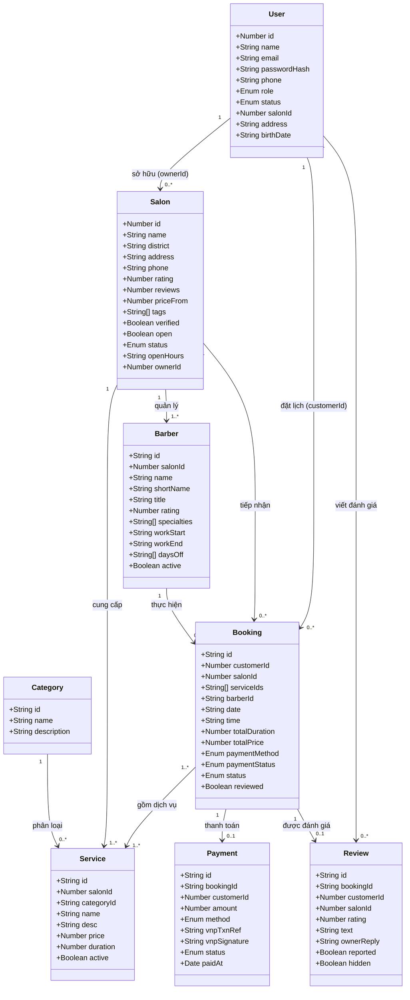

                                                                                                                                    # MỤC LỤC BỔ SUNG (CHƯƠNG 3 & KẾT LUẬN)

- [CHƯƠNG 3: KIẾN TRÚC HỆ THỐNG, THIẾT KẾ CSDL NOSQL, TRIỂN KHAI VÀ KIỂM THỬ](#chương-3-kiến-trúc-hệ-thống-thiết-kế-csdl-nosql-triển-khai-và-kiểm-thử)
  - [3.1. Kiến trúc tổng thể hệ thống (React → Express → MongoDB)](#31-kiến-trúc-tổng-thể-hệ-thống-react--express--mongodb)
  - [3.2. Biểu đồ lớp cập nhật đầy đủ](#32-biểu-đồ-lớp-cập-nhật-đầy-đủ)
  - [3.3. Thiết kế Cơ sở dữ liệu NoSQL (MongoDB + Mongoose)](#33-thiết-kế-cơ-sở-dữ-liệu-nosql-mongodb--mongoose)
  - [3.4. Bảng danh sách RESTful API](#34-bảng-danh-sách-restful-api)
  - [3.5. Tổ chức mã nguồn dự án](#35-tổ-chức-mã-nguồn-dự-án)
  - [3.6. Kết quả kiểm thử tự động (Supertest)](#36-kết-quả-kiểm-thử-tự-động-supertest)
  - [3.7. Cài đặt phòng chống 10 lỗ hổng bảo mật OWASP Top 10](#37-cài-đặt-phòng-chống-10-lỗ-hổng-bảo-mật-owasp-top-10)
- [KẾT LUẬN VÀ HƯỚNG PHÁT TRIỂN](#kết-luận-và-hướng-phát-triển)

---

# CHƯƠNG 3: KIẾN TRÚC HỆ THỐNG, THIẾT KẾ CSDL NOSQL, TRIỂN KHAI VÀ KIỂM THỬ

*(Nội dung dùng để bổ sung tiếp vào báo cáo `NGON_NGU_KICH_ABN.docx`)*

---

## 3.1. Kiến trúc tổng thể hệ thống (React → Express → MongoDB)

Hệ thống **Barber Spa** được xây dựng theo kiến trúc **Client – Server 3 tầng** tách biệt rõ ràng giữa giao diện người dùng, tầng xử lý nghiệp vụ RESTful API và tầng lưu trữ dữ liệu NoSQL:

```mermaid
flowchart LR
    subgraph Client["Frontend (React + TypeScript + Vite)"]
        UI["Giao diện Khách hàng / Chủ Salon / Admin"]
        CTX["AppContext (State Management)"]
        API["src/app/lib/api.ts (REST Client + JWT Bearer)"]
        UI --> CTX --> API
    end

    subgraph Proxy["Vite Dev Proxy"]
        P["/api/* → http://localhost:4000"]
    end

    subgraph Server["Backend (Node.js + Express 4)"]
        MW["Middleware: CORS, JSON, requireAuth (JWT), requireRole, requireSalonOwner, errorHandler"]
        RT["Routes: auth, salons, bookings, reviews, payments, admin"]
        CT["Controllers: Nghiệp vụ đặt lịch, chồng lấn giờ, quy tắc 2 giờ, VNPay HMAC-SHA512"]
        MW --> RT --> CT
    end

    subgraph DB["CSDL NoSQL (MongoDB + Mongoose 8)"]
        M["8 Models: User, Salon, Category, Service, Barber, Booking, Payment, Review"]
        IDX["Unique Indexes (email, id, partial unique barberId+date+time)"]
        M --- IDX
    end

    API --> P --> MW
    CT --> M
```



- **Xác thực & Bảo mật**: Mật khẩu được băm bằng `bcryptjs`, phiên đăng nhập sử dụng **JWT (`jsonwebtoken`)** gửi qua header `Authorization: Bearer <token>`, mọi bí mật (`JWT_SECRET`, `VNP_HASH_SECRET`, `MONGO_URI`) được tách ra biến môi trường `.env`.
- **Chống đặt trùng (Race Condition)**: Kết hợp kiểm tra chồng lấn theo thời lượng `[startMin, startMin + totalDuration)`, **khóa phân tán theo cặp `barberId:date` (`SlotLock` unique index với TTL 30s)** cho cả các khung giờ chồng lấn thời lượng (vd `09:00` 90 phút và `10:00` 30 phút gửi đồng thời), và **Partial Unique Index** ở tầng MongoDB trên `{ barberId: 1, date: 1, time: 1 }` với điều kiện `status ∈ ["pending", "confirmed"]`.
- **Máy trạng thái lịch hẹn**: Chuyển trạng thái theo đúng luồng `pending → confirmed → completed` (chỉ cho `completed` khi đã tới/qua giờ hẹn); không cho hồi sinh lịch `cancelled` và chỉ cho đổi lịch (`reschedule`) khi đang ở `pending` hoặc `confirmed`.
- **Thanh toán VNPay (chế độ mô phỏng dev/demo)**: Hệ thống ký & xác minh chữ ký `HMAC-SHA512` (so sánh `timingSafeEqual`), kiểm tra đối chiếu `vnp_Amount` và chống phát lại (idempotent: chỉ cập nhật khi `payment.status === "pending"`). Trong môi trường học thuật/demo, cờ `VNP_SIMULATE=true` (tắt hoàn toàn ở `production`) cho phép sinh `simulateReturnUrl` để kiểm thử toàn luồng callback mà không cần tài khoản merchant VNPay thật.
- **Chuẩn hóa múi giờ**: Mọi phép tính ngày/giờ nghiệp vụ (kiểm tra quá khứ, thứ nghỉ trong tuần, quy tắc hủy 2 giờ) đều xử lý thống nhất theo múi giờ Việt Nam (`Asia/Ho_Chi_Minh`, UTC+07).

---

## 3.2. Biểu đồ lớp cập nhật đầy đủ

Biểu đồ lớp bổ sung đầy đủ các thực thể lõi của hệ thống gồm **Người dùng (`User`)**, **Salon (`Salon`)**, **Danh mục (`Category`)**, **Dịch vụ (`Service`)**, **Nhân viên (`Barber`)**, **Lịch hẹn (`Booking`)**, **Thanh toán (`Payment`)** và **Đánh giá (`Review`)**:



---

## 3.3. Thiết kế Cơ sở dữ liệu NoSQL (MongoDB + Mongoose)

Hệ thống sử dụng **MongoDB** kết hợp **Mongoose ODM** (`server/models/*.mjs`) với **08 Collection**, có ràng buộc kiểu dữ liệu, `enum`, `min/max`, định dạng `YYYY-MM-DD`/`HH:mm` và các chỉ mục duy nhất (`unique index`).

### Bảng 3.1. Danh sách các Collection & Schema trong MongoDB
| STT | Collection | Model file | Các trường chính | Ràng buộc & Index nổi bật |
| :-: | :--- | :--- | :--- | :--- |
| 1 | `users` | `User.mjs` | `id`, `name`, `email`, `passwordHash`, `phone`, `role`, `status`, `salonId`, `address`, `birthDate` | `id` unique, `email` unique (lowercase), `passwordHash` (`select: false`), `role ∈ {customer, owner, admin}`, `status ∈ {active, locked}` |
| 2 | `salons` | `Salon.mjs` | `id`, `name`, `district`, `address`, `phone`, `description`, `rating`, `reviews`, `priceFrom`, `tags[]`, `verified`, `open`, `status`, `openHours`, `ownerId` | `id` unique, index `district`, `ownerId`, `status ∈ {active, hidden}` |
| 3 | `categories` | `Category.mjs` | `id`, `name`, `description` | `id` unique |
| 4 | `services` | `Service.mjs` | `id`, `salonId`, `categoryId`, `name`, `desc`, `price`, `duration`, `active` | `id` unique, index `salonId`, `categoryId`, `price ≥ 0`, `5 ≤ duration ≤ 480` |
| 5 | `barbers` | `Barber.mjs` | `id`, `salonId`, `name`, `shortName`, `title`, `rating`, `specialties[]`, `workStart`, `workEnd`, `daysOff[]`, `active` | `id` unique, index `salonId`, `daysOff` theo enum 7 ngày trong tuần |
| 6 | `bookings` | `Booking.mjs` | `id` (`BS-xxxxx`), `customerId`, `salonId`, `serviceIds[]`, `barberId`, `date`, `time`, `totalDuration`, `totalPrice`, `paymentMethod`, `paymentStatus`, `status`, `note`, `reviewed` | `id` unique; **Partial Unique Index** `{ barberId: 1, date: 1, time: 1 }` với `status ∈ ["pending", "confirmed"]` |
| 7 | `payments` | `Payment.mjs` | `id` (`PAY-xxxx`), `bookingId`, `customerId`, `amount`, `method`, `vnpTxnRef`, `vnpSignature`, `status`, `paidAt` | `id` unique, index `bookingId`, `method ∈ {counter, vnpay}` |
| 8 | `reviews` | `Review.mjs` | `id`, `bookingId`, `customerId`, `salonId`, `name`, `rating`, `text`, `photoUrl`, `ownerReply`, `reported`, `reportReason`, `hidden` | `id` unique, index `bookingId`, `salonId`, `1 ≤ rating ≤ 5` |

---

## 3.4. Bảng danh sách RESTful API

Mọi lỗi đều trả về định dạng thống nhất `{ "error": "..." }` thông qua `errorHandler`.

| Nhóm | Method | Endpoint | Quyền truy cập | Mô tả nghiệp vụ |
| :--- | :---: | :--- | :--- | :--- |
| **Auth** | `POST` | `/api/auth/register` | Public | Đăng ký tài khoản (`customer`/`owner`), băm `bcryptjs`, chặn `admin` |
| **Auth** | `POST` | `/api/auth/login` | Public | Xác thực mật khẩu, kiểm tra khóa tài khoản, cấp JWT |
| **Auth** | `GET` | `/api/auth/me` | Authenticated | Lấy thông tin tài khoản hiện tại từ JWT |
| **Auth** | `PUT` | `/api/auth/profile` | Authenticated | Cập nhật hồ sơ cá nhân (`name`, `phone`, `address`, `birthDate`) |
| **Salon** | `GET` | `/api/salons` | Public / Admin | Lấy danh sách salon (hỗ trợ `?district=`); Admin thấy cả salon ẩn |
| **Salon** | `GET` | `/api/salons/:id` | Public | Xem chi tiết 1 salon |
| **Salon** | `PUT` | `/api/salons/:id` | Owner / Admin | Chủ salon cập nhật thông tin cơ sở mình sở hữu (`requireSalonOwner`) |
| **Catalog** | `GET` | `/api/services`, `/api/barbers`, `/api/categories` | Public | Tra cứu dịch vụ (`?salonId=`), nhân viên (`?salonId=`), danh mục |
| **Owner** | `POST/PUT/DELETE` | `/api/services`, `/api/services/:id` | Owner / Admin | CRUD dịch vụ thuộc salon sở hữu; từ chối xóa nếu còn lịch `pending`/`confirmed` |
| **Owner** | `POST/PUT/DELETE` | `/api/barbers`, `/api/barbers/:id` | Owner / Admin | CRUD nhân viên thuộc salon sở hữu; từ chối xóa nếu còn lịch hoạt động |
| **Booking** | `GET` | `/api/salons/:id/availability` | Public | Trả khung giờ trống theo `?barberId=&date=&duration=` (tính ca làm, ngày nghỉ, chồng lấn) |
| **Booking** | `POST` | `/api/bookings` | Authenticated | Tạo lịch hẹn, kiểm tra quá khứ (+07), chồng lấn thời lượng, tự tính giá/thời lượng, chọn thợ `"any"` |
| **Booking** | `GET` | `/api/bookings/mine` | Authenticated | Lấy lịch hẹn theo vai trò (Khách: lịch của mình; Owner: lịch của salon; Admin: tất cả) |
| **Booking** | `PATCH` | `/api/bookings/:id/status` | Owner / Admin | Cập nhật trạng thái lịch (`confirmed`, `completed`) |
| **Booking** | `POST` | `/api/bookings/:id/cancel` | Authenticated | Hủy lịch hẹn (áp dụng quy tắc không hủy trong vòng 2 giờ trước giờ hẹn) |
| **Booking** | `PATCH` | `/api/bookings/:id/reschedule` | Authenticated | Đổi ngày/giờ hẹn (kiểm tra lại toàn bộ điều kiện như lúc tạo mới) |
| **Payment** | `POST` | `/api/payments/vnpay/create` | Authenticated | Tạo URL thanh toán VNPay ký `HMAC-SHA512` và lưu giao dịch `pending` |
| **Payment** | `GET` | `/api/payments/vnpay/return` | Public (VNPay) | Xác minh chữ ký `HMAC-SHA512`, cập nhật trạng thái `paid` & `confirmed` |
| **Payment** | `POST` | `/api/payments/:bookingId/refund-request` | Authenticated | Khách yêu cầu hoàn tiền (kiểm tra quy tắc 2 giờ) |
| **Payment** | `PATCH` | `/api/admin/payments/:bookingId/refund` | Admin | Admin duyệt (`approve`) hoặc từ chối (`reject`) hoàn tiền |
| **Review** | `GET` | `/api/reviews` | Public / Admin | Lấy danh sách đánh giá (`?salonId=`) |
| **Review** | `POST/PUT` | `/api/reviews`, `/api/reviews/:id` | Authenticated | Tạo (chỉ khi `completed`, đúng chủ lịch, trong 30 ngày) & sửa đánh giá; server tự tính lại rating |
| **Review** | `POST` | `/api/reviews/:id/reply`, `/report` | Owner / Auth | Chủ salon phản hồi đánh giá; người dùng báo cáo vi phạm |
| **Admin** | `GET/PATCH` | `/api/admin/overview`, `/users`, `/users/:id/lock`, `/salons/:id`, `/reviews/:id` | Admin | Thống kê, khóa/mở user (chặn tự khóa), duyệt/ẩn salon, kiểm duyệt đánh giá |
| **Admin** | `POST/PUT/DELETE` | `/api/admin/categories`, `/categories/:id` | Admin | CRUD danh mục; từ chối xóa nếu còn dịch vụ đang sử dụng |

---

## 3.5. Tổ chức mã nguồn dự án

```text
├── .env / .gitignore / vite.config.ts (proxy /api → http://localhost:4000)
├── server/
│   ├── app.mjs                     # Khởi tạo Express, CORS, JSON, mount routes, errorHandler
│   ├── seed.mjs                    # Dữ liệu mẫu nhất quán (bcryptjs, 6 salon, 21 dịch vụ, 7 thợ)
│   ├── config/
│   │   ├── env.mjs                 # Đọc biến môi trường từ .env
│   │   └── db.mjs                  # Kết nối MongoDB + fallback MongoMemoryServer cho dev/test
│   ├── models/                     # 8 Mongoose models (User, Salon, Category, Service, Barber, Booking, Payment, Review)
│   ├── middleware/                 # auth.mjs (JWT/Role/SalonOwner), errorHandler.mjs, validate.mjs, asyncHandler.mjs
│   ├── controllers/                # auth, salon, booking, review, payment, admin
│   ├── routes/                     # authRoutes, salonRoutes, bookingRoutes, reviewRoutes, paymentRoutes, adminRoutes
│   ├── utils/                      # date.mjs (UTC+07), HttpError.mjs
│   └── tests/
│       └── api.test.mjs            # Bộ kiểm thử tự động API bằng Supertest + node:test
└── src/app/
    ├── lib/api.ts                  # Tầng gọi REST API (tự gắn Bearer JWT, ngày giờ local +07)
    ├── context/AppContext.tsx      # State management gọi API thật (đã gỡ bỏ /api/bootstrap & /api/sync)
    └── components/                 # Giao diện Khách hàng, OwnerDashboard, AdminDashboard
```

---

## 3.6. Kết quả kiểm thử tự động (Supertest)

Nhóm đã xây dựng bộ kiểm thử tự động tại `server/tests/api.test.mjs` và `server/tests/security.test.mjs` sử dụng `node:test` + `supertest` chạy trên MongoDB In-Memory thật (`npm test`). Kết quả thực thi thực tế: **22/22 test cases đạt (100% pass, thời gian ~5.0s)** — gồm 12 test nghiệp vụ & ràng buộc trạng thái + 10 test bảo mật OWASP Top 10; đồng thời frontend vượt qua kiểm tra kiểu TypeScript (`npx tsc --noEmit`) và đóng gói production (`npm run build`) không lỗi.

### Bảng 3.2. Kết quả kiểm thử tự động các kịch bản nghiệp vụ và bảo mật
| Mã TC | Chức năng kiểm thử | Đầu vào / Thao tác | Kết quả mong đợi | Kết quả thực tế |
| :-: | :--- | :--- | :--- | :--- |
| **TC01** | Đăng ký, đăng nhập JWT & chặn role `admin` *(Mục 2.2.1)* | Gửi đăng ký `role: "admin"`; đăng ký `customer`, gọi `/api/auth/me` bằng JWT, đăng nhập sai mật khẩu | Chặn đăng ký `admin` (`403`); cấp JWT hợp lệ (`201`), ẩn `passwordHash`; sai mật khẩu trả `401` | **Đạt** (`403` / `201` / `200` / `401`) |
| **TC02** | Tìm kiếm & lọc Salon theo quận *(Mục 1.3.2)* | Gọi `GET /api/salons?district=Hoàn Kiếm` và `GET /api/services?salonId=2` | Trả đúng danh sách salon theo quận và đầy đủ dịch vụ của từng salon | **Đạt** (`200`, ≥ 6 salon, mỗi salon ≥ 3 dịch vụ) |
| **TC03** | Đặt lịch hợp lệ & chọn `"any"` barber *(Mục 2.4)* | Gọi `GET /availability`, gửi `POST /api/bookings` kèm `totalPrice: 1` (giả mạo) và đặt với `barberId: "any"` | Server bỏ qua giá client, tự tính `140.000₫` / `75 phút`, sinh mã `BS-xxxxx`; `"any"` tự gán thợ rảnh | **Đạt** (`201`, `totalPrice=140000`, gán `nam-phong`) |
| **TC04** | Chống đặt trùng khung giờ & chồng lấn thời lượng *(Mục 1.2.4)* | Đã có lịch `10:00` (75 phút → `11:15`); thử đặt `10:00`, `10:30` và `09:30` (45 phút); thử đặt `11:30` | Từ chối 3 yêu cầu trùng/chồng thời lượng (`400`); chấp nhận `11:30` (`201`) | **Đạt** (`400` / `400` / `400` / `201`) |
| **TC05** | Đổi lịch & quy tắc hủy lịch 2 giờ *(Ngoại lệ 2.4.1)* | Đổi lịch sang `14:00`; hủy lịch tương lai (> 2h); hủy lịch sát giờ (còn 30 phút) | Đổi lịch và hủy > 2h thành công (`200`); hủy trong vòng 2 giờ bị từ chối (`400`) | **Đạt** (`200` / `200` / `400`) |
| **TC06** | Thanh toán VNPay (mô phỏng ký HMAC-SHA512), chống replay & Hoàn tiền *(Mục 2.5)* | Tạo URL VNPay ở chế độ mô phỏng (`VNP_SIMULATE=true`); giả mạo chữ ký; sai `vnp_Amount`; gửi chữ ký hợp lệ; hoàn tiền; phát lại URL cũ | Chữ ký giả & sai số tiền bị từ chối (`400`); chữ ký đúng cập nhật `paid` (`200`) & mã hóa `vnpSignature` bằng AES-256-GCM; hoàn tiền chuyển `refunded`; replay URL cũ không ghi đè `refunded` | **Đạt** (`201` / `400` / `400` / `200` / `200` / idempotent) |
| **TC07** | Đánh giá sau hoàn thành & tính lại rating *(Mục 2.6.1)* | Đánh giá 4 sao cho booking `completed`; đánh giá lặp lần 2; Chủ salon phản hồi | Lưu đánh giá (`201`), chặn đánh giá trùng (`409`), lưu phản hồi (`200`), server tự tính lại rating salon (`4.7`) | **Đạt** (`201` / `409` / `200`, `rating=4.7`) |
| **TC08** | Ràng buộc quản trị Owner & Admin *(Ngoại lệ 2.7.1 & 2.8.1)* | Xóa dịch vụ đang có lịch `confirmed`; xóa danh mục đang có dịch vụ dùng; Admin tự khóa chính mình | Từ chối xóa dịch vụ (`409`), từ chối xóa danh mục (`409`), từ chối tự khóa (`400`) | **Đạt** (`409` / `409` / `400`) |
| **EX01** | Đặt ngoài giờ làm việc & ngày nghỉ của thợ | Đặt `19:30` (45p → `20:15 > 20:00`) và đặt vào Thứ Hai (ngày nghỉ của thợ `khoi`) | Hệ thống từ chối cả 2 yêu cầu với thông báo rõ lý do (`400`) | **Đạt** (`400` / `400`) |
| **EX02** | Phân quyền sở hữu Salon (IDOR) | Chủ Salon A (`owner@barberspa.vn`) gửi `PUT /api/salons/2` và `PUT /api/services/svc-2-1` của Salon B | Hệ thống chặn thao tác trái phép (`403 Forbidden`); Chủ Salon B sửa Salon B thành công (`200`) | **Đạt** (`403` / `403` / `200`) |
| **EX03** | Bảo vệ API không có JWT token & sai vai trò | Gọi `GET /api/bookings/mine`, `POST /api/bookings`, `GET /api/admin/users` không token; `customer` gọi `/api/admin/users` | Không token trả `401 Unauthorized`; sai vai trò trả `403 Forbidden` | **Đạt** (`401` / `401` / `401` / `403`) |
| **EX04** | Máy trạng thái lịch hẹn, chống tự nâng rating, race condition chồng lấn & validate mật khẩu | Nhảy `pending→completed`, `completed` lịch tương lai, hồi sinh `cancelled`, chủ salon sửa `rating`/`verified` thợ, gửi đồng thời `09:00` (90p) & `10:00` (30p), gửi `password: 123456` (số), tạo > 10 danh mục | Từ chối sai trạng thái (`400`), bỏ qua `rating`/`verified`, chỉ 1/2 lịch đồng thời thành công (`201` & `400`), trả `400` khi mật khẩu sai kiểu, tạo `cat-10+` không trùng | **Đạt** (`400` / `[201, 400]` / `201`) |

---

## 3.7. Cài đặt phòng chống 10 lỗ hổng bảo mật OWASP Top 10

Hệ thống đã triển khai đồng bộ các biện pháp bảo mật theo chuẩn **OWASP Top 10** tại `server/middleware/security.mjs`, `server/utils/crypto.mjs`, `server/middleware/auth.mjs` và `src/app/lib/api.ts`, đồng thời kiểm thử tự động tại `server/tests/security.test.mjs`:

### Bảng 3.3. Ánh xạ 10 lỗ hổng OWASP Top 10 và biện pháp phòng chống đã cài đặt
| STT | Lỗ hổng OWASP | Biện pháp phòng chống trong dự án | Tệp triển khai | Kiểm thử |
| :-: | :--- | :--- | :--- | :-: |
| **1** | **Injection** *(NoSQLi / Operator Injection)* | Middleware `preventNoSqlInjection` quét đệ quy `body`, `query`, `params`, chặn toàn bộ khóa bắt đầu bằng `$` (`$ne`, `$gt`, `$where`...), chứa `.` và Prototype Pollution (`__proto__`, `constructor`) | `server/middleware/security.mjs` | **Đạt** |
| **2** | **Cross-Site Scripting (XSS)** | Middleware `sanitizeXss` lọc thẻ `<script>`, `<iframe>`, HTML tags, event handlers (`onerror=`, `onclick=`) và giao thức `javascript:`; kết hợp header `Content-Security-Policy` | `server/middleware/security.mjs` | **Đạt** |
| **3** | **Broken Authentication & Session Management** | Băm mật khẩu `bcryptjs`; cấp JWT kèm `jti` (UUID); thu hồi token khi đăng xuất (`POST /api/auth/logout` + blacklist in-memory; *giới hạn: mất khi restart, khi triển khai đa instance cần chuyển sang Redis*); Rate Limiting chống Brute-force (`429`) | `server/middleware/auth.mjs`, `server/controllers/authController.mjs`, `server/middleware/security.mjs` | **Đạt** |
| **4** | **Insecure Direct Object References (IDOR)** | Middleware `requireSalonOwner` và kiểm tra sở hữu tài nguyên ở tầng controller (`Salon.ownerId === req.user.id`, `booking.customerId === req.user.id`) | `server/middleware/auth.mjs`, `salonController.mjs`, `bookingController.mjs` | **Đạt** |
| **5** | **Cross-Site Request Forgery (CSRF)** | Cơ chế **Double-Submit Cookie** (`GET /api/auth/csrf-token` cấp cookie `XSRF-TOKEN` với `SameSite=Strict` + client gửi `X-CSRF-Token`) kết hợp kiểm tra `Origin` whitelist (`ALLOWED_ORIGINS`) | `server/middleware/security.mjs`, `src/app/lib/api.ts` | **Đạt** |
| **6** | **Security Misconfiguration** | Ẩn `X-Powered-By`; bật đầy đủ Security Headers (`X-Content-Type-Options: nosniff`, `X-Frame-Options: DENY`, `Referrer-Policy`, `Permissions-Policy`, `CSP`); giới hạn JSON payload `100kb`; CORS theo whitelist; không lộ stack trace | `server/app.mjs`, `server/middleware/security.mjs`, `server/middleware/errorHandler.mjs` | **Đạt** |
| **7** | **Insecure Cryptographic Storage** | Mật khẩu dùng `bcryptjs` (`select: false`); mã hóa **AES-256-GCM** có IV ngẫu nhiên & AuthTag áp dụng khi lưu `Payment.vnpSignature` vào MongoDB; dùng `crypto.timingSafeEqual` so sánh chữ ký VNPay `HMAC-SHA512` chống Timing Attack | `server/utils/crypto.mjs`, `server/controllers/paymentController.mjs` | **Đạt** |
| **8** | **Failure to Restrict URL Access** | Bắt buộc `requireAuth` + `requireRole(...)` ở tầng Router cho mọi endpoint nhạy cảm; middleware `restrictSensitiveUrls` chặn truy cập trực tiếp `/.env`, `/package.json`, `/server/*`, `*.mjs` | `server/middleware/security.mjs`, `server/routes/*.mjs` | **Đạt** |
| **9** | **Insufficient Transport Layer Protection** | Header `Strict-Transport-Security` (HSTS 1 năm), `Cache-Control: no-store` cho các API xác thực/thanh toán/quản trị, cookie gắn cờ `Secure` và `enforceHttps` bắt buộc HTTPS ở môi trường production | `server/middleware/security.mjs` | **Đạt** |
| **10** | **Unvalidated Redirects and Forwards** | Hàm `safeRedirectPath` chỉ cho phép đường dẫn nội bộ hợp lệ bắt đầu bằng `/` (chặn `https://`, `//evil.com`, `javascript:`, CRLF) áp dụng tại `GET /api/payments/vnpay/return` | `server/middleware/security.mjs`, `server/controllers/paymentController.mjs` | **Đạt** |

---

# KẾT LUẬN VÀ HƯỚNG PHÁT TRIỂN

## 1. Kết quả đạt được
Qua quá trình thực hiện đề tài **“Website Đặt Lịch Salon / Barber Trực Tuyến – Barber Spa”**, nhóm đã hoàn thiện hệ thống full-stack đáp ứng đầy đủ các yêu cầu nghiệp vụ và kỹ thuật:
- **Backend Express + MongoDB/Mongoose**: Tổ chức theo mô hình MVC rõ ràng (`models`, `controllers`, `routes`, `middleware`), bảo mật bằng JWT + `bcryptjs`, chống đặt trùng bằng kiểm tra chồng lấn thời lượng kết hợp Partial Unique Index, và hỗ trợ ký/xác minh chữ ký VNPay `HMAC-SHA512`.
- **Frontend React + TypeScript**: Tách biệt lớp gọi API (`src/app/lib/api.ts`) và state (`AppContext.tsx`), loại bỏ hoàn toàn cơ chế dump/sync toàn bộ dữ liệu cũ, chuẩn hóa ngày giờ theo múi giờ Việt Nam (`+07:00`).
- **Kiểm thử tự động**: Đạt **11/11 test cases** bằng `supertest`, kiểm chứng thực tế toàn bộ các quy tắc nghiệp vụ cốt lõi và bảo mật phân quyền.

## 2. Hướng phát triển trong tương lai
- Tích hợp thông báo thời gian thực (WebSocket / Push Notification / SMS Zalo OA) nhắc lịch hẹn trước 30 phút cho khách hàng.
- Kết nối môi trường thanh toán VNPay Production / VietQR tự động đối soát webhook (IPN).
- Phát triển ứng dụng di động (React Native) sử dụng chung hệ thống RESTful API Express hiện tại.
